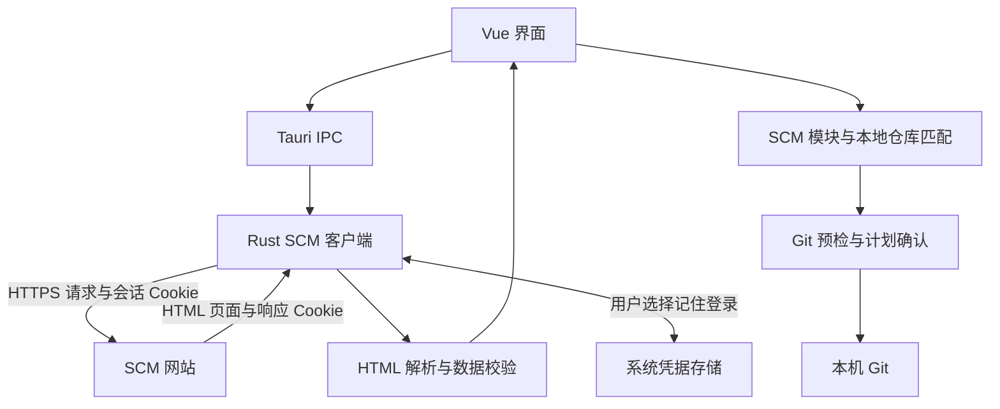
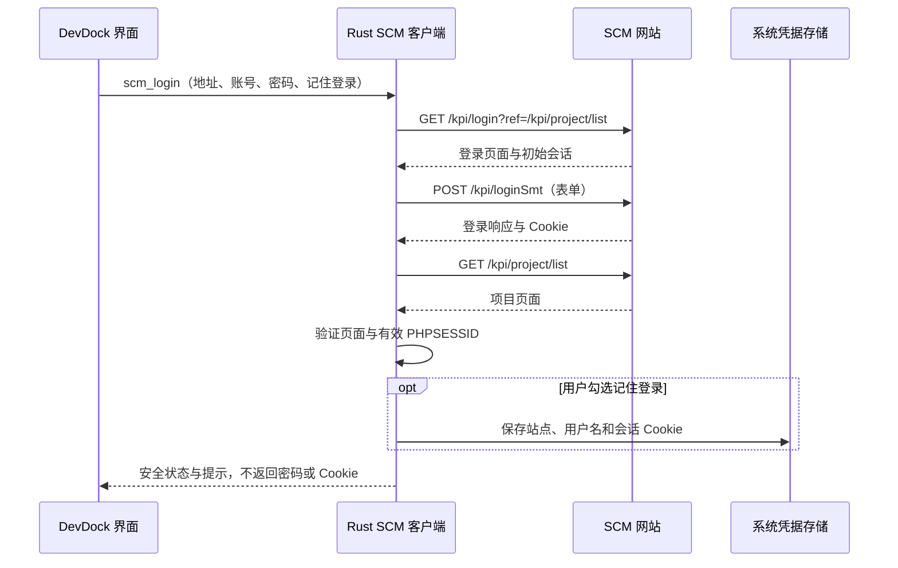

# SCM 登录与项目读取流程

本文说明 DevDock 当前的 SCM 登录、会话管理、项目与模块读取、本地仓库匹配及 Git 操作流程。示例统一使用 `https://scm.example.invalid`，不包含真实站点、账号或业务项目数据。

## 1. 实现方式与适用范围

DevDock 通过 Rust HTTP 客户端访问 SCM 的表单接口和 HTML 页面，再将解析后的结构化数据交给 Vue 界面。日常登录和读取不依赖浏览器自动化，也不需要用户复制 Cookie。



当前适配依赖这套 SCM 的接口路径、`PHPSESSID` 会话和页面结构：

- 同一站点的其他项目，可以按当前账号权限读取。
- 相同系统部署在其他域名时，接口和 HTML 结构一致才可能直接兼容。
- GitHub、GitLab、Gitee 等不同平台不能直接套用此登录方式，需要独立适配。
- SCM 地址必须是 HTTPS 根地址，例如 `https://scm.example.invalid`，不能包含账号密码、额外路径、查询参数或片段。

## 2. 登录流程

前端输入地址、用户名和密码，调用 `api.scmLogin()`，经 Tauri IPC 进入 Rust 的 `Runtime::login()`。



登录提交使用表单编码，字段如下：

| 字段       | 来源或固定值        |
| ---------- | ------------------- |
| `username` | 用户输入的登录账号  |
| `password` | 用户输入的密码      |
| `ref`      | `/kpi/project/list` |
| `act`      | `loginSubmit`       |
| `submit`   | `Enter`             |

判断成功不能只看 HTTP 200。后端还会检查响应是否仍为登录页面、项目列表能否解析，以及 Cookie Jar 中是否有有效的 `PHPSESSID`。

HTTP 请求仅允许同源 HTTPS 重定向，最多五跳；连接超时为 10 秒，请求超时为 25 秒。原始网络错误、登录页面正文和 Cookie 不作为错误消息直接回传界面。

## 3. 会话管理与退出

Rust 使用 `reqwest` 的 Cookie Jar 接收并自动携带 Cookie，后续读取复用当前会话，无需重复提交密码。

| 情况           | 行为                                                                     |
| -------------- | ------------------------------------------------------------------------ |
| 未勾选记住登录 | 会话保留在当前进程内                                                     |
| 勾选记住登录   | 将站点地址、用户名和会话 Cookie 保存到 macOS 钥匙串或 Windows 凭据管理器 |
| 应用重新启动   | 首次使用 SCM 时尝试恢复已记住的会话，再请求 SCM 验证有效性               |
| Cookie 未变化  | 不重复写入系统凭据存储                                                   |
| 保存会话失败   | 保留当前内存会话并提示，不随每次查询反复重试授权                         |
| 发现会话过期   | 清理当前会话并提示重新登录，不自动提交密码                               |
| 点击退出登录   | 清理本机内存会话，并尝试删除已记住的凭据                                 |

密码经登录 IPC 传给 Rust，用于此次表单请求，不加入已记住会话或普通项目配置。前端在登录成功、失败、会话过期和组件卸载时清空密码字段。

退出登录不会调用 SCM 的远端 `loginOut`，也不会退出其他浏览器会话。系统凭据写入或删除失败时会显示警告，不能据此假定旧凭据已被清除；如果旧记录仍保留，重启后可能恢复旧会话。

界面已登录时只展示站点地址、用户名和状态操作；未登录或会话过期时展示登录表单。

## 4. 获取项目列表

点击“加载项目列表”后，前端调用 `api.scmProjects()`，Rust 使用当前会话发送：

```text
GET /kpi/project/list
    author=<当前登录用户名>
    show=1
    project_name=
```

| 参数            | 用途                         |
| --------------- | ---------------------------- |
| `author`        | 按当前登录账号进行负责人筛选 |
| `show=1`        | 对应 SCM 页面中的“全部”状态  |
| `project_name=` | 不限制项目名称               |

实际核验发现，该站点的无参数列表只返回两个测试项目；带当前账号和“全部”状态后，才包含该账号的待处理项目。仅增加 `show=1` 会扩大到其他账号的项目，因此需要同时传入负责人条件。结果仍以 SCM 服务端权限和筛选规则为准。

返回值是 HTML，Rust 按“项目ID”“项目名称”“项目状态”表头定位列，提取为：

```ts
interface ScmProject {
  id: string;
  name: string;
  status: string | null;
}
```

解析保留以下校验：

- 项目 ID 必须为不超过 20 位的纯数字，项目名称不能为空。
- 缺列、汇总等不符合项目行结构的数据会跳过；重复项目 ID 报错。
- 不以是否存在标准详情链接作为收录条件。
- 如果明确的项目详情链接中的有效 ID 与当前行 ID 冲突，则排除该行。

前端开发和测试来源使用同一份项目候选。下拉默认最多显示六行，超出部分滚动查看，支持按 ID/名称搜索、键盘选择和手动输入项目链接。六行是显示高度限制，不是把返回数据截断为六项。

## 5. 获取模块、仓库编号和分支

用户填写开发 SCM 项目 ID，以及可选的测试 SCM 项目 ID，再点击“加载模块”。每个被请求的项目分别读取：

| 请求                                               | 用途                               |
| -------------------------------------------------- | ---------------------------------- |
| `GET /kpi/project/project?show_type=2&id=<项目ID>` | 获取项目关联模块及模块分支         |
| `GET /kpi/gitmode/list`                            | 获取 SCM Git ID、模块名和 Git 地址 |

模块页面解析规则：

1. 查找 `.modelist` 模块容器，忽略 `mode_template` 隐藏模板。
2. 从 `.subpro[id]` 读取模块名称。
3. 从 `.message` 中的“分支:”或“分支：”文字提取分支名。
4. 从模块链接的 `g_pid` 参数读取 SCM Git ID。
5. 与仓库列表中的编号、模块名和 Git 地址交叉核对。

模块名称、编号冲突或缺少分支时会明确报错，不猜测映射。SCM 返回的仓库地址会先进行格式验证和 URL 凭据清理；缺少地址时仍可保留仓库编号用于匹配。

返回前端的数据为：

```ts
interface ScmModule {
  gitId: string | null;
  moduleName: string;
  gitRemoteUrl: string | null;
  branch: string;
}
```

这里有两种不同的编号：**SCM 项目 ID**用于选择一项需求或测试项目，**SCM Git ID**用于识别其中的代码仓库。同一个 Git 仓库可以出现在多个 SCM 项目中，并使用不同分支。

## 6. 与本地仓库匹配

前端先读取已配置本地仓库的 Git 状态及远端地址，再调用 `syncBackendModules()`：

1. 本地已有 SCM Git ID 时，优先按该编号匹配开发模块。
2. 没有编号时，按规范化后的 Git 远端地址唯一匹配。
3. 不按目录名猜测；匹配不唯一时提示核对。
4. 开发分支取自开发 SCM 模块。
5. 填写测试来源时，按相同 SCM Git ID 查找唯一测试分支；没有明确匹配则清空旧测试目标并提示。
6. 未填写测试来源时，不请求测试模块，也不清空已经保存的测试目标。
7. 自动填入映射并保存，收到父组件的准确保存回执后才视为成功；失败可重新加载模块重试。

“SCM 项目与仓库”中，已匹配的仓库只展示一次，集中显示目录、SCM 分支和本地当前分支。未匹配的开发模块提供关联目录入口，但不能勾选执行 Git 操作；测试来源独有模块不展示。其余本地配置仍保留，不因当前筛选而删除。

## 7. 本地 Git 操作与 SCM 的边界

SCM 负责提供项目、模块和分支信息。本地操作由 Rust 调用本机 Git 完成，使用本机 SSH 密钥或 Git 凭据，与 SCM 登录会话独立。

| 操作               | 执行位置及行为                                                                        |
| ------------------ | ------------------------------------------------------------------------------------- |
| 切换开发分支       | 在原项目目录检出开发 SCM 对应分支                                                     |
| 切换到测试分支     | 在原项目目录检出测试目标，不合并、不推送                                              |
| 切换 master 分支   | 在原项目目录检出 `master`；不存在时提示，不改切其他分支                               |
| 合并到测试分支     | 在独立 Git worktree 中合并已确认开发提交，原项目目录保留开发分支；冲突时保留 worktree |
| 推送开发分支到远程 | 当前必须在开发分支；确认后普通推送已确认提交到远端同名分支                            |

这些操作均先预检，再由用户确认执行。未提交修改、合并/变基状态、目标不可用或执行前状态变化等，会根据具体操作阻止执行。批次按仓库顺序执行，遇错暂停，之前成功的结果不自动回滚。

只有明确选择相应推送操作并确认计划后才会写入远端，不执行强制推送。DevDock 不调用 SCM 的“我要开始”、修改项目、编译、部署、上线或网页合并接口。

## 8. 数据保存边界

| 数据                                | 保存位置或流向                                               |
| ----------------------------------- | ------------------------------------------------------------ |
| 登录密码                            | 登录输入与请求过程，不加入普通配置或已记住会话               |
| 会话 Cookie                         | Rust 内存；记住登录时进入系统凭据存储，不返回前端            |
| SCM 地址、登录用户名                | 会话状态返回前端展示；记住登录时随会话保存                   |
| 项目 ID、模块名、仓库路径、分支映射 | 普通项目配置及配置备份                                       |
| Git 计划、执行结果、保留工作树位置  | 应用数据目录中的 `backend-worktrees/<操作ID>/operation.json` |

项目配置、导出备份和操作记录仍可能包含业务信息、本机目录及环境变量。公开源码不等于可以公开这些运行数据。

## 9. 实现入口

| 文件                                                           | 职责                                                  |
| -------------------------------------------------------------- | ----------------------------------------------------- |
| [ScmConnection.vue](../src/components/ScmConnection.vue)       | 登录表单、已登录摘要、密码字段清理及状态提示          |
| [ScmProjectInput.vue](../src/components/ScmProjectInput.vue)   | 六行候选列表、搜索、键盘选择和手工输入                |
| [BackendWorkbench.vue](../src/components/BackendWorkbench.vue) | 项目来源选择、加载模块、自动保存、Git 计划与操作结果  |
| [api.ts](../src/api.ts)                                        | 前端 Tauri IPC 调用封装                               |
| [types.ts](../src/types.ts)                                    | 前端项目、模块、会话及 Git 数据类型                   |
| [scm.rs](../src-tauri/src/scm.rs)                              | HTTP 登录、Cookie Jar、凭据存储、页面读取与 HTML 解析 |
| [backend-mapping.ts](../src/backend-mapping.ts)                | SCM 模块和本地仓库匹配                                |
| [backend_git.rs](../src-tauri/src/backend_git.rs)              | 本地 Git 状态、预检、切换、合并、推送及恢复记录       |
| [lib.rs](../src-tauri/src/lib.rs)                              | Tauri 命令注册与调用入口                              |

SCM 接口路径、筛选参数或页面结构变化时，应更新对应适配和合成测试。涉及 Rust 的修复需要重新构建并启动桌面后端，单独刷新前端页面不会应用这些变更。
